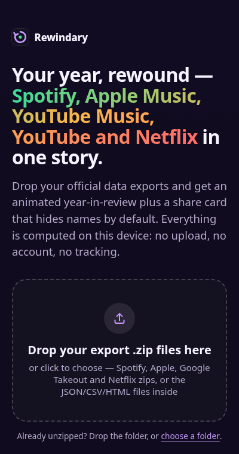
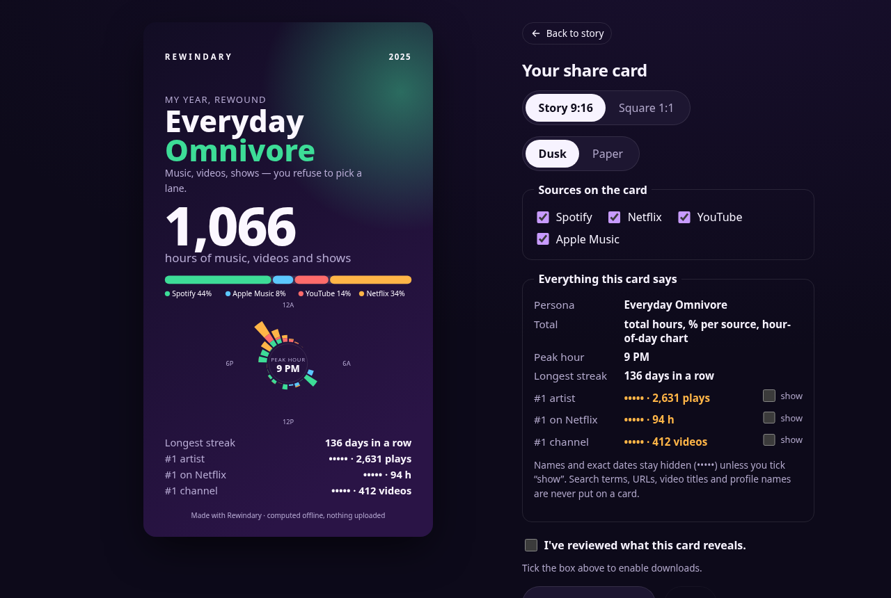

> **Built by Claude in a public race vs GPT** — opponent: [Abo Killer](https://github.com/ArthurRavel/abo-killer)
>
> [&style=social)](https://github.com/ArthurRavel/rewindary) [&style=social)](https://github.com/ArthurRavel/abo-killer)

# Rewindary

**Your Spotify, Apple Music, YouTube and Netflix year, rewound into one story, entirely in your browser.**

Drop the official data exports and you get an animated, mobile-first year in review that reads across all of them (your day clock, your seasons, your busiest day, binges, rabbit holes and streaks), plus a share card that hides names and exact dates until you opt in. No upload, no account, no API key, nothing to install.

<p align="center"></p>

<sub>The GIF shows real screenshots of the production build, captured automatically by <code>scripts/e2e.mjs --shots</code>. All data in it is synthetic: the artists, channels and shows are invented.</sub>

## What it does

- **Four import adapters:** Spotify extended streaming history (or the 1-year account data), Apple Music play activity (Apple's privacy download, read straight from its nested `Apple_Media_Services.zip`), Google Takeout (YouTube watch and search history, Google Search activity, in JSON or HTML), and Netflix viewing activity (full data request, or the quick titles-and-dates CSV). You can drop the `.zip` files as they are; known history files are decompressed in full and photos and videos are never inflated; other `.json` and `.html` entries only have their first 32 KB looked at, and are dropped unless they open like Google activity. A Takeout in another language (French, German, Spanish… file and folder names) is read too: the importer recognises Google activity by how the file starts, not by its name.
- **Unzipped folders work too.** Safari on macOS unzips downloads by default, so an export often arrives as a folder (`Takeout/`, `Spotify Extended Streaming History/`). Drop the folder, or use "choose a folder" (desktop browsers; the option is hidden on phones and tablets). Inside a folder the same rules apply as inside a zip: only `.zip`, `.json`, `.csv` and `.html` files are opened, Google Photos sidecars (`IMG_0001.jpg.json`) and media are skipped by name, and a folder with no history gets one note saying which export to request.
- **One local event model.** Every source becomes the same `LifeEvent` shape (`src/model.ts`), so the metrics run across sources:
  - total hours and the share for each source
  - a 24-hour day clock stacked by source, plus your peak hour and how much happened at night
  - which source "owned" each season
  - how the year compares with the one before, over the same dates and per source (a source counts only when its history reaches back to that January, and both years stop where the stalest export ends, so an unfinished year is never set against a full one)
  - your most plugged-in day, broken down by source
  - your longest daily streak and longest offline break
  - your biggest Netflix binge, deepest YouTube rabbit hole and longest music run (Spotify and Apple Music together)
  - "second screen" time, when music played while a video or show was on
  - a persona such as *Midnight Soundtracker* or *Weekend Binge Scholar*
- **A story:** tap or arrow keys to move, auto-advance with pause, and support for `prefers-reduced-motion`.
- **Share cards:** 9:16 story or 1:1 square, two themes, PNG or SVG. A review panel lists *every* line the card will contain (the panel and the renderer share one function). Personal values (#1 artist, show and channel, and the exact date of your busiest day) appear as `•••••` until you tick "show". You can drop whole sources from the card. Downloads stay disabled until you confirm that you've reviewed the card. Every card ends with the same footer, "Made on-device with Rewindary · arthurravel.github.io/rewindary", so someone who sees your card can find the app; it is listed in the review panel too, and it is the only address a card ever carries.
- **Privacy receipt.** After your files are parsed, the review screen shows what this tab actually did: requests to other sites (none), attempts the Content-Security-Policy blocked, how many page files loaded from the site itself, and whether anything was saved in the browser. It reads the browser's own request log (Resource Timing) and CSP reports, shows hosts only (never paths or queries), sends nothing, and can be re-checked at any time.
- **Explains files it can't use.** If a dropped export has no usable history, the review screen says what it was and what to request instead: a Takeout with YouTube data but no history (and a reminder that big Takeouts come in several zips), a Spotify export without streaming history, a Netflix export without `ViewingActivity.csv`, or an unsupported archive. It reads only file and archive-entry names to decide, and you can add the missing export from the same screen.
- **Link previews.** Pasting the app's address into a chat or a post shows a title, a one-line description and a preview image (`public/og.jpg`, 1200×630) instead of a bare URL. The image shows the synthetic demo's default share card, with the #1 artist hidden; `pnpm og-image` re-captures it from the production build. The tags are only read by whatever unfurls the link: the page itself never loads the image.
- **A link to the code.** The start page and the end of the story link to this repository, so "open source" can be checked. It is a plain link, opened in a new tab with no referrer only if you click it; nothing is loaded from it.
- **Netflix profile filter** for shared accounts, a year or all-time selector, and per-source toggles.
- **Synthetic demo.** The demo generates two years of fake Spotify, Apple Music, Google Takeout and Netflix exports in the real formats and runs them through the same parsers as your files.



## Privacy model

| Guarantee | How it is enforced | How it is tested |
|---|---|---|
| Files never leave the device | Parsing runs in a Web Worker on `File` objects. The production `index.html` ships a Content-Security-Policy with `connect-src 'none'`, `default-src 'none'`, no remote scripts, fonts or styles | E2E test in real Chromium: fails if *any* request leaves the local origin, and checks that a deliberate `fetch()` to a remote host is **blocked** by the CSP |
| No telemetry, analytics, CDNs or remote fonts | No such code exists; system font stack only | `tests/privacy-source.test.ts` scans the source for network APIs. `scripts/check-dist.mjs` scans the built bundle for remote URLs and network APIs and checks that the CSP is present |
| Nothing persisted | No cookies, `localStorage`, `IndexedDB` or service worker. Closing the tab forgets everything | E2E asserts empty `localStorage`, `sessionStorage` and cookies |
| Minimal data kept in memory | Adapters drop IP addresses, countries, devices, platforms, Apple IDs and bookmarks. **Search terms and URLs are discarded at parse time**, so a search becomes a bare timestamp. Ads, trailers, sub-minute previews and Spotify **private-session plays are excluded** | Parser tests assert that the synthetic IPs, queries, URLs and device names are absent from the parsed events |
| Safe share cards | Names and exact dates are hidden by default. Titles, search terms, URLs from your history and profile names are never on a card; the only address on it is Rewindary's own, in the footer. User strings are XML-escaped | `tests/cards.test.ts` renders every format and theme from a full synthetic year and asserts that no name, title, profile, URL or exact date appears, and that the footer address is the only one. The E2E test downloads the real PNG and SVG and checks them |

**Threat model.** Rewindary protects you against the app itself, its hosting and its dependencies exfiltrating your history: the browser enforces the CSP even if the code had a bug. It also protects you from oversharing by accident through a card. It does **not** protect against a compromised browser or extension, or against someone with access to your unlocked device while the tab is open. The CSP is delivered as a `<meta>` tag because GitHub Pages cannot set headers. That covers network requests, but not `frame-ancestors`. If you don't want to trust the hosted copy, build it yourself (see below) and open `dist/` from any static server, or check DevTools → Network.

**Estimates are labelled.** YouTube history has no durations, so Rewindary estimates each video from the gap to the next one (1–15 min, 8 min when the next watch is far away). The quick Netflix CSV has no durations or times, so it uses 40 min per episode and 100 min per film and leaves those rows out of hour-of-day charts. The story shows the estimated share of your total.

## Get your data

Exports come straight from each service and some take days, so request them first. Menu labels change over time; these steps describe the flows as of November 2026.

**Spotify: extended streaming history** (Spotify says it can take up to 30 days)
1. Sign in at spotify.com and open Account → Privacy settings ("Download your data").
2. Tick **Extended streaming history**, request it, and confirm the email.
3. Download `my_spotify_data.zip` and drop it in as it is. Rewindary reads `Streaming_History_Audio_*.json` (older exports use `endsong_*.json`). The quicker "Account data" export (`StreamingHistory_music_*.json`) also works, but it covers only about a year. If you provide both, the extended history wins and duplicates are merged.

**Apple Music: Apple Media Services information** (Apple says up to 7 days)
1. Sign in at privacy.apple.com and choose **Request a copy of your data**.
2. Select only **Apple Media Services information**, continue and complete the request.
3. Download the zip from Apple's email (all parts, if it is split) and drop it as it is. Rewindary opens the `Apple_Media_Services.zip` inside it and reads `Apple Music Activity/Apple Music Play Activity.csv`. Only song, artist, times, play durations and the event type are read; the Apple ID, IP address, device and storefront columns are never looked at. A play is a `PLAY_END` row of at least 5 seconds. Some exports have no artist names; the story then ranks songs.
4. The other files in that folder (for example `Apple Music - Play History Daily Tracks.csv`) are not read: they have no per-play times.

**YouTube and Google Search: Google Takeout** (minutes to hours)
1. Open takeout.google.com and click **Deselect all**.
2. Tick **YouTube and YouTube Music** → "All YouTube data included" → keep only **history**.
3. Optional: tick **My Activity** and keep only **Search** to add your search rhythm. Only the timestamps are used.
4. Pick JSON under "Multiple formats" if you can. HTML works too: dates in English, French, German, Spanish, Italian and Portuguese formats are parsed.
5. Drop the `.zip`.

**Netflix: viewing activity**
- Best: in your account, open **Download your personal information** (up to 30 days) and drop the `.zip`. It contains `CONTENT_INTERACTION/ViewingActivity.csv` with exact start times and durations.
- Instant: Account → Profile → **Viewing activity → Download all** gives `NetflixViewingHistory.csv`. It has titles and dates only, so durations are estimated. Day-first and month-first dates are detected automatically.

## Competition and naming (checked 9 Nov 2026)

We are **not** the first multi-source "wrapped" for personal data, and we don't claim to be.

| Project | Sources | Where computation runs | Open source | Install |
|---|---|---|---|---|
| **Rewindary** | Spotify, Apple Music, YouTube + Google Search, Netflix | Browser only; CSP blocks all network; tested | Yes (MIT) | None (static page) |
| [superwrapped.com](https://superwrapped.com) | Netflix, Strava, Goodreads, Letterboxd, Google Maps | Raw data in browser; precomputed summaries may be sent out for insight generation | No | None |
| [abdullahasghar966/life-wrapped](https://github.com/abdullahasghar966/life-wrapped) | Spotify, YouTube, Netflix (same combination as ours) | Browser (per its description) | No license stated | — |
| [facebookresearch/personal-timeline](https://github.com/facebookresearch/personal-timeline) | Many personal-data sources, as a timeline | Local Python/Docker | Yes | Heavy |
| [middlewarehq/unwrapped](https://github.com/middlewarehq/unwrapped) | GitHub (developer year) | Server | Yes | — |
| Many single-source tools (Spotify, Netflix or YouTube "wrapped") | One each | Varies | Varies | Varies |

What sets Rewindary apart, as plainly as we can say it:
- metrics that read *across* sources (day clock, seasons, busiest day, second-screen time, persona) rather than separate dashboards
- share cards that hide personal values by default, with a review step that shows exactly what will be exported
- a no-network guarantee enforced by the browser and verified by automated tests
- zero install, MIT-licensed

The Spotify + YouTube + Netflix combination on its own is *not* unique. Apple Music support was added on 11 Nov 2026; we did not re-run the competitor survey for it.

**Name audit.** "Unwrapped" (crowded on GitHub, npm package taken, `unwrapped.app` registered) and "Lifeprint" (taken) were rejected. On 9 Nov 2026, **Rewindary** returned no GitHub repositories and no npm package. `rewindary.com`, `.app`, `.io` and `.dev` didn't resolve, and a web search found no product by that name. This was not a trademark search.

## Run, test, build

You need Node ≥ 20. Use any package manager. If you have neither npm nor pnpm on your PATH, Node's bundled Corepack works: `corepack pnpm@9.15.0 <command>`.

```sh
pnpm install          # or: npm install / corepack pnpm@9.15.0 install
pnpm dev              # local dev server
pnpm verify           # typecheck → unit tests → production build → dist privacy scan → browser E2E
pnpm demo-gif         # re-capture screenshots from the build and regenerate docs/media/demo.gif
pnpm og-image         # re-capture public/og.jpg, the link-preview image, from the build
```

What `verify` runs, exactly:
- `tsc --noEmit`: strict TypeScript.
- `node scripts/run-tests.mjs`: 107 Vitest tests in 11 files, run in UTC.
  - Parsers: every format, including edge cases (skips, incognito, ads, trailers, removed videos, localized HTML dates, CSV quoting).
  - Ingest: streamed zips, unrelated entries skipped, de-duplication, Spotify source preference, YouTube duration estimates.
  - Insights: streaks, breaks, busiest day, binges, overlap, persona, default year, year-over-year comparison (same-date windows, coverage, stale exports, Feb 29), the deterministic synthetic years across all four services.
  - Redaction: all card formats and themes, review lines equal card lines, XML escaping, the footer (once per card, the only address on it, and it fits).
  - Privacy receipt: same-origin vs external hosts, blocked attempts by host only, stored items.
  - Localized Takeouts: history under French, German and Spanish file names, the content check that decides what is kept (and that photo sidecars, bookmarks and Maps activity are not), thousands of tiny entries in one archive, stored (uncompressed) entries, and an entry with a compression method it cannot read.
  - Unzipped folders: a Takeout folder gives the same events as its zip, photos and sidecars are never opened, unreadable peeked files are skipped, one note per folder without history, zips inside a folder, the batched directory walk.
  - Unrecognised files: Takeout with YouTube data but no history (and split parts), Takeout of other products, Spotify and Netflix exports without history, unsupported archives, history-named files that don't parse.
  - Apple Music: header detection, only `PLAY_END` rows count (with a fallback when there are none), UTC timestamps, skips and broken rows, no Apple ID/IP/device in the events, the nested `Apple_Media_Services.zip` (one level only), a missing-artist export, the 30 s play rule, the shared music persona and listening run, the #1 artist on cards and a four-source legend that fits the card.
  - Link previews: the build adds Open Graph and X tags whose only absolute URLs are the app's own address and its `og.jpg`, copies the page's title and description (a quote in them cannot break a tag), and the image is a 1200×630 JPEG under 300 KB.
  - Source privacy scan: no network APIs; the only remote URLs are the demo's synthetic data and the source-code link, which must open in a new tab with no referrer or opener.
- `vite build`: static output in `dist/` with a relative base, ready for GitHub Pages. About 79 KB of JS (≈30 KB gzipped) plus a 26 KB parser worker. Runtime dependencies are `preact` and `fflate`.
- `node scripts/check-dist.mjs`: no remote URLs or network APIs in the bundle (the exact source-code link is the one allowed URL besides the demo's synthetic data and the SVG namespace), and a strict CSP is present. It also checks that the link-preview tags point at the app's own address (the only other absolute URLs allowed in `index.html`) and that `og.jpg` ships as a 1200×630 JPEG under 300 KB.
- `node scripts/e2e.mjs`: drives the built site in headless Chromium, served under `/rewindary/` exactly like the GitHub Pages project site (any request outside that path fails the run). `E2E_URL=https://arthurravel.github.io/rewindary/ node scripts/e2e.mjs` runs the same checks against the deployed copy.
  - Runs the demo through every slide (including Apple Music and the four-source year-over-year comparison), then tests the review gate and the PNG (1080×1920) and SVG exports, with and without revealed names. Checks the source-code link on the start page and the end slide (new tab, no referrer or opener), the footer line in the review panel, and that the exported card carries the app address once and no other link.
  - Uploads zipped and plain fixtures for Spotify, Google and Netflix, and Apple's nested privacy zip (play activity read, its own story slide, the #1 artist hidden on the card review).
  - Checks the link-preview tags, that `og.jpg` is served next to the app, and that the page never loads it.
  - Checks zero external requests, that the CSP blocks a deliberate `fetch`, empty storage, and no page errors.
  - Checks that the privacy receipt reports no external requests, then surfaces the deliberate blocked `fetch` by host only after "Check again".
  - Uploads a Takeout part with no history, checks the explanation and that there is nothing to play, then adds the missing export from the same screen.
  - Uploads a Takeout whose files have French names and checks that it is read with no stray notes.
  - Picks an unzipped Takeout folder and adds a Spotify folder from the review screen, then really drops a folder (through Chromium's DevTools protocol, since Playwright cannot drop directories) and a folder holding only photos.
  - It uses `CHROME_PATH`, or a Chromium already in the Playwright cache. It downloads nothing.

All fixtures in `tests/fixtures/` and all demo data are synthetic. Documentation IP addresses (`192.0.2.x`) and an invented country code `ZZ` stand in for real values.

## Deploy

The live site is served by GitHub Pages from the `gh-pages` branch, which holds only a built `dist/` (plus `.nojekyll`). Each release runs `pnpm verify` locally, then commits that exact verified `dist/` to `gh-pages` with the `main` commit it was built from in the message. There is no CI workflow in this repository. To host a fork, change the two lines in `src/site.ts` (the address printed on cards and in the link-preview tags, and the source link) and the copies pinned in `scripts/check-dist.mjs`, `scripts/e2e.mjs` and `tests/privacy-source.test.ts`, run `pnpm og-image` so the preview image shows your address, then `pnpm verify` and publish `dist/` the same way (Settings → Pages → Deploy from a branch → `gh-pages`). Any static host works too, since the build uses relative paths.

## Project layout

```
src/model.ts        unified LifeEvent model
src/parsers/        spotify.ts · apple.ts · google.ts · netflix.ts · text.ts (CSV, entities, loose dates)
src/ingest.ts       streaming unzip + unzipped folders + format detection (by name, then by content) + merge/dedupe
src/insights.ts     cross-source metrics and persona
src/cards.ts        share-card lines + SVG renderer (redaction lives here)
src/receipt.ts      privacy receipt (reads Resource Timing + CSP reports, sends nothing)
src/diagnose.ts     explains unrecognised files from their names (what to request instead)
src/demo.ts         deterministic synthetic exports
src/ui/             Preact screens: Home, Review, Story, Share; folders.ts walks dropped and chosen folders
scripts/            e2e, dist privacy scan, static server, GIF builder
docs/race-log.md    daily public race log
```

## License

MIT. Not affiliated with Spotify, Apple, Google, YouTube or Netflix.

This is an experimental test project entirely managed by AI.
